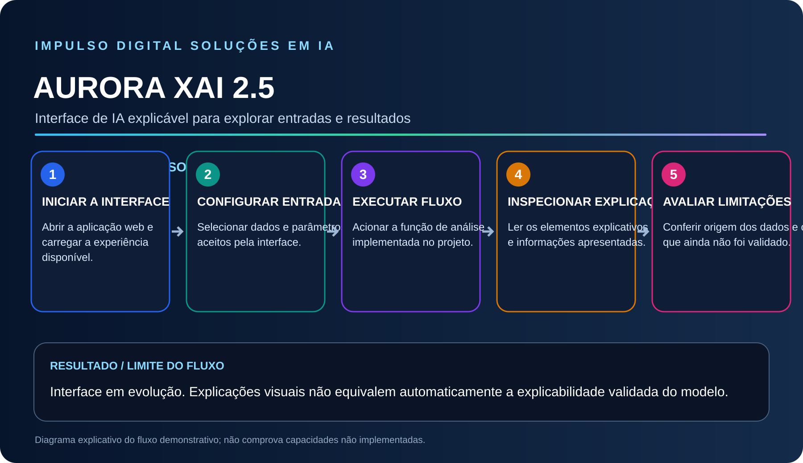
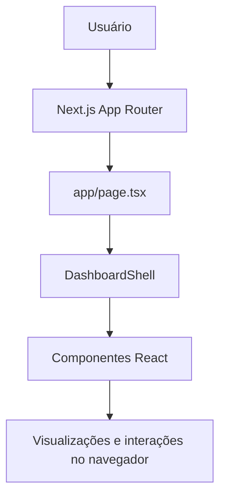

# Aurora XAI 2.5

<p align="center"></p>


Interface web experimental da Impulso Digital, construída com Next.js e React. O repositório contém uma aplicação de painel; a implementação deve ser avaliada pelo código disponível, sem interpretar os textos institucionais da interface como comprovação de integrações, auditorias ou controles regulatórios em produção.

> **Maturidade:** protótipo de interface. Este repositório não declara, por si só, conexão operacional com sistemas governamentais, instituições financeiras, bases externas ou infraestrutura de segurança certificada.

## Objetivo

Organizar uma experiência web para apresentar informações e módulos associados ao conceito Aurora XAI. O escopo funcional exato é definido pelos componentes presentes em `components/` e pelas páginas em `app/`.

## Arquitetura observável

- **Framework:** Next.js 16 (App Router).
- **Interface:** React 19 e TypeScript.
- **Estilos:** Tailwind CSS 4 e utilitários de classes.
- **Visualização de dados:** Recharts.
- **Ícones:** Lucide React.
- **Analytics:** integração com Vercel Analytics carregada apenas em produção.
- **Configuração:** TypeScript em modo strict e alias `@/*` apontando para a raiz.

Fluxo de alto nível:



## Requisitos

- Node.js compatível com a versão do Next.js utilizada.
- npm, pnpm ou yarn.
- Acesso à internet para instalar dependências e carregar fontes/serviços externos declarados pela aplicação.

## Instalação e execução

```bash
git clone https://github.com/felipetjmg1-bit/aurora-xai-2-5.git
cd aurora-xai-2-5
npm install
npm run dev
```

Abra [http://localhost:3000](http://localhost:3000).

## Comandos disponíveis

| Comando | Finalidade |
| --- | --- |
| `npm run dev` | Inicia o servidor de desenvolvimento |
| `npm run build` | Gera a build de produção |
| `npm run start` | Inicia a aplicação compilada |
| `npm run lint` | Executa o ESLint |

Para validar antes de publicar:

```bash
npm run lint
npm run build
```

## Configuração e segurança

- Não coloque tokens, senhas, chaves privadas ou credenciais no código-fonte.
- Use variáveis de ambiente para integrações futuras e mantenha arquivos `.env.local` fora do Git.
- Revise os textos da interface para distinguir dados demonstrativos de dados reais.
- A presença de um painel visual não comprova que os indicadores estejam conectados a fontes externas.

## Estado e próximos passos

Este README descreve a estrutura identificada no repositório. Antes de considerar o projeto pronto para produção, execute lint e build, revise acessibilidade e responsividade, documente cada fonte de dados e implemente testes para os fluxos críticos.

## Contribuição

Mudanças devem incluir uma descrição do objetivo, arquivos afetados, passos de validação e limitações conhecidas. Não envie dados pessoais ou segredos em issues e pull requests.

## Licença

Consulte o arquivo [LICENSE](LICENSE) para os termos aplicáveis.


**Empresa responsável:** Impulso Digital Soluções em IA.
